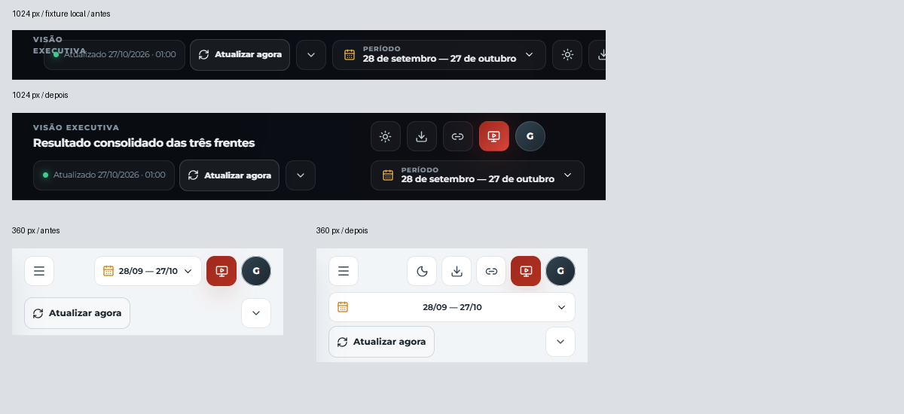

# Entrega 01 · Navegação e acessibilidade

Estado: **corrigido e validado localmente; publicação pendente**. Base: `37f3d785f0a1d6a41830252babbba113609df39f`.

## Problema e solução

- **F01/P1:** regiões explícitas de título, status, período e ferramentas no cabeçalho. Abaixo de 1600 px passam a duas linhas; abaixo de 640 px, três. O conteúdo acompanha a altura real reservada. Ações não encolhem nem ficam fora da tela.
- **F02/P1:** o Popover existente recebe o foco, contém Tab/Shift+Tab, torna o fundo inerte enquanto aberto, fecha com Escape/clique externo e devolve o foco ao gatilho. O calendário embutido usa a semântica do Popover, preservando seu uso independente.
- **F09/P2:** manter todas as ações visíveis também restitui o tema no celular e no compartilhamento.

O custo é uma faixa de cabeçalho mais alta nos tamanhos intermediários/móveis. Não há nova biblioteca, alteração de contratos ou redesign. As regras do cabeçalho ficam em `styles.css`; `data-sync.css` cuida do painel e deixa de reposicionar globalmente o cabeçalho. O componente de lightbox e a implementação de previews permanecem intactos.

## Validação

Transporte sintético em memória, sem sessão ou credenciais reais e sem sincronização/gravação de produção. Os números/imagens locais são fixtures, não evidência de dados reais.

- Testes relevantes: 21/21 (Popover, navegação Shell e painel de atualização). Suíte completa: 604/607 na primeira rodada, com três timeouts de 5 s. Reexecução isolada dos dois arquivos afetados: **36/36**, incluindo as três falhas, sem ampliar o timeout. Cobertura consolidada: 607 testes aprovados; não é uma rodada única de 607 aprovações.
- Playwright: seis resoluções, dois temas; áreas úteis equivalentes a zoom de 125/150% (1152×720 e 960×600). Essa redução de viewport não comprova o zoom nativo do navegador.
- Teclado: período, menu do usuário e fontes em 1440/1024/390/360 px; foco inicial, limites Tab/Shift+Tab, Escape, restauração e aplicação de período.
- Regressão: Site/GA4, apresentação, filtros de plataforma, comparação com frente indisponível, Top 3/9, lightbox e tema no compartilhamento móvel.
- Typecheck e build do frontend.

Playwright consolidado: **22 cenários aprovados**. A rodada final teve 20/22, com dois timeouts antes de carregar a view (módulos locais pendentes no trace); os dois passaram isoladamente (2/2). Depois, os quatro fluxos de teclado foram confirmados novamente nas alturas exatas de 1440×900, 1024×768, 390×844 e 360×800 (4/4). Os JSONs originais e das repetições foram preservados separadamente em `artifacts/uiux-01/`.

As capturas de cabeçalho nas 16 combinações de tamanho/tema (incluindo as duas áreas equivalentes a zoom) e os quatro conjuntos de diálogos foram inspecionados visualmente. Sem sobreposição entre controles, elementos do cabeçalho fora da tela ou overflow horizontal global medido. Os achados restantes do diagnóstico continuam abertos.

`typecheck` e `build` passaram na versão final. O build mantém o aviso preexistente de chunks maiores que 500 kB. A execução inicial do Vitest em `forks` apresentou problemas de arquivos temporários no isolamento do Windows; a validação local foi feita com `--maxWorkers 1 --pool threads`. O workflow de produção não foi modificado.

Reprodução sem credenciais: `npx playwright test --config playwright.uiux.config.ts`. O servidor e o transporte de teste usam apenas endereços locais; qualquer origem externa é bloqueada. Capturas integrais/JSON: `artifacts/uiux-01/` (ignorados pelo Git).

## Antes/depois e publicação

[1024 antes](images/header-1024-before.png) · [1024 depois](images/header-1024-after.png) · [360 antes](images/header-360-before.png) · [360 depois](images/header-360-after.png). As capturas originais são preservadas no pacote local; os recortes acima mantêm a escala em pixels CSS.

[Período em 390×844, com foco no diálogo](images/period-390.png). O ciclo de foco é comprovado pelos testes de teclado, não apenas pela imagem.

PR, commit integrado, Actions, Pages e leitura pós-publicação serão registrados conforme concluídos. Sem sessão autenticada autorizada disponível, a homologação autenticada de produção permanece **pendente**; fixtures não a substituem.
