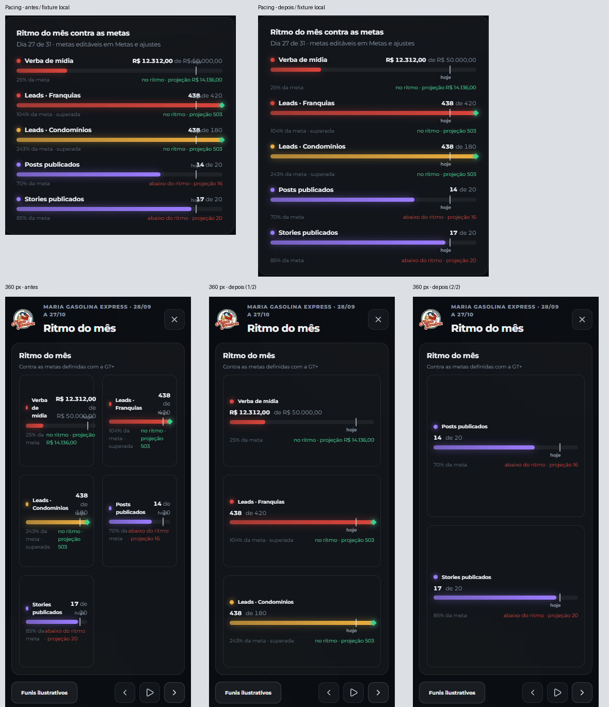

# Entrega 02 · Metas e apresentação

Estado: **publicado; validado localmente e leitura pública confirmada; homologação autenticada pendente**. Base atualizada após o PR #11: `acf5844c8c67890e7e26bc5eb3ea98d3c57db49b`.

## Correções

- **F03/P1:** “hoje” ocupa uma linha própria, no fluxo do componente Pacing. A legenda acompanha proporcionalmente o marcador e permanece dentro da barra nos extremos do mês. Valor e meta ficam separados em unidades que não quebram os números. Cálculos de metas, percentuais, projeção e ritmo permanecem iguais.
- **F04/P1:** a apresentação usa uma coluna de metas abaixo de 700 px, com até três indicadores por slide (dois em telas baixas). Em telas mais largas e baixas, até quatro; nas demais, mantém os cinco. Todos os cinco aparecem uma única vez. A seleção do conteúdo ativo é preservada ao redimensionar, inclusive quando os itens são reagrupados.

Mantidos marca, paleta e componentes existentes. O efeito nas outras telas limita-se à composição visual do Pacing compartilhado por Executiva e frentes conectadas. O custo é uma página adicional de metas em celular/zoom com pouca altura.

## Verificações

- 39/39 testes relevantes: Executiva, frentes sem fonte/conectadas, métricas e paginação da apresentação. Incluem cobertura de todas as metas, etapas de CRM e ranking dos criativos preservados, e permanência do conteúdo ativo no resize.
- Typecheck e build aprovados. O build local usa endereço/chave explicitamente sintéticos. O deploy é reconstruído pelo workflow com sua configuração própria.
- Primeira passagem Playwright: 5/5 em 360×800, início/fim do mês, meta extensa, meta zerada/estado vazio e resize.
- Matriz completa: **42/42 aprovados**, sem repetição por falha. Seis resoluções/dois temas, mais áreas úteis equivalentes a zoom de 125/150%; Executiva, Condomínios, Franquias e todos os slides. Inclui os 22 cenários da entrega 01, com filtros, Top 3/9, lightbox, foco e compartilhamento.
- Conferência final após preservar o espaço textual entre valor e “de”: typecheck/build aprovados, mais **5/5 Playwright** e **39/39 testes relevantes** na versão final. O teste verifica também o texto legível/copíavel, não apenas caixas e pixels.
- Inspeção visual: pranchas das composições e abertura em escala nativa dos marcadores, metas móveis em ambas as páginas, tema claro/escuro e frente com anel de CPL. Valores sem cortes ou sobreposição; textos dentro dos cards; sem overflow medido em todos os slides. F06 (contraste) continua pendente e não foi considerado resolvido.

Para evitar carregamento de centenas de módulos de desenvolvimento, esta entrega usa o build servido em `127.0.0.1:5197` e a mesma API sintética em `127.0.0.1:55498`. O catálogo original em `5196` permanece disponível. A fixture aceita a origem local de teste e bloqueia todas as outras; não foi acrescentada sessão ou fonte real.

Reprodução: gerar `npm run build` com `VITE_SUPABASE_URL=http://127.0.0.1:55498` e `VITE_SUPABASE_PUBLISHABLE_KEY=sb_publishable_AUDIT_SYNTHETIC_ONLY`; depois `npx playwright test --config playwright.uiux-goals.config.ts`. Saídas integrais: `artifacts/uiux-02/`.

## Antes/depois

[Marcador antes](images/pacing-before.png) · [Marcador depois](images/pacing-after.png) · [360 antes](images/presentation-360-before.png) · [360 depois 1/2](images/presentation-360-after.png) · [360 depois 2/2](images/presentation-360-after-page2.png) · [390 claro antes](images/presentation-390-before.png) · [390 claro depois](images/presentation-390-after.png).

As imagens usam a mesma data e dados controlados do diagnóstico, sem consultas/gravações reais. Os recortes do Pacing têm alturas distintas porque a legenda agora reserva espaço próprio no fluxo.

## Compatibilidade e publicação

`Presentation.tsx` e `presentation-layout.ts` são compartilhados pela apresentação de criativos. A alteração restringe-se às páginas de metas e à permanência do conteúdo durante resize. Seleção/ranking, quantidade por página de criativos, extração, armazenamento, atualização seletiva e coletores Meta não mudaram; não foi antecipado código do PR #10.

## Publicação concluída em 28/10/2026

- [PR #12](https://github.com/jonathanmainel/maria-gasolina-dashboard/pull/12), correção `0d1cef15fa140426c88dd42d3b6136d8310859bc`, merge `b1103467737289c765c3b190a6cb61e2d96bf34b`.
- [Actions/Pages](https://github.com/jonathanmainel/maria-gasolina-dashboard/actions/runs/40694444935): build/deploy concluídos, **54 arquivos / 614 testes aprovados**, typecheck e build aprovados.
- Leitura real em [Pages](https://jonathanmainel.github.io/maria-gasolina-dashboard/): HTTP 200; CSS global com a nova legenda e CSS lazy da apresentação com a nova grade confirmados. Login em 1440×900 e 390×844 sem runtime/configuração/overflow ou requisição de gravação; capturas idênticas byte a byte à entrega 01. [Registro](production-verification.json).
- Homologação autenticada de Pacing e apresentação **pendente**. Contexto novo sem sessão, sem credenciais, OAuth, fixtures ou sincronização de produção.
- Arquivos de produto: `src/components/ui/primitives.tsx`, `src/styles.css`, `src/presentation.css`, `src/lib/presentation-layout.ts`, `src/views/Presentation.tsx`. Demais arquivos: testes, harness local, documentação e evidências.
- Quatro P1 publicados. Restam nove achados P2/P3; próxima entrega: F12, isoladamente e sobre a main atualizada.
