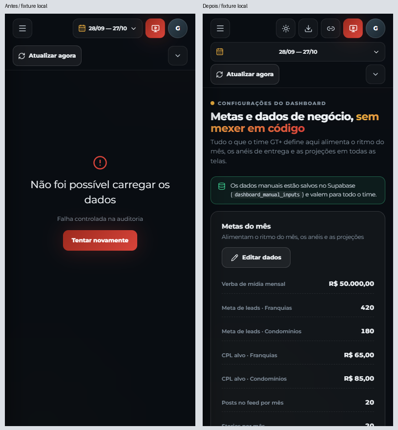
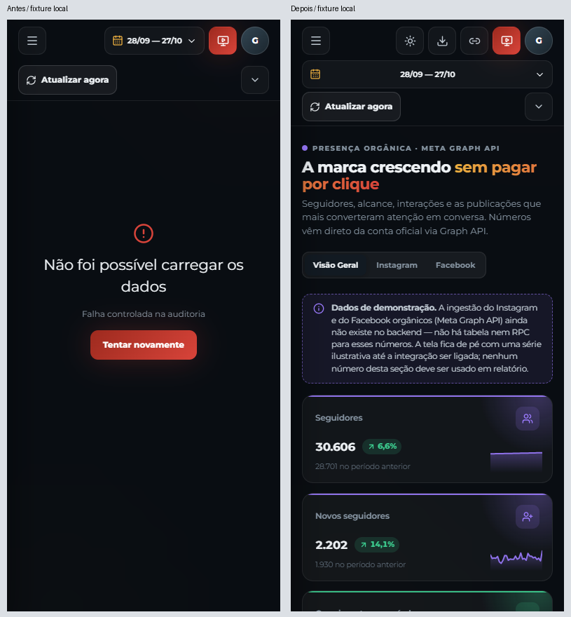

# Entrega 03 · Estados proporcionais às fontes

Estado: **publicado; validado localmente e leitura pública confirmada; homologação autenticada pendente**. Base: `b1103467737289c765c3b190a6cb61e2d96bf34b`, após o PR #12 e confirmação de seu Pages.

## F12/P2

Configurações passa a usar o estado da sua consulta de dados manuais; Orgânico usa o estado da consulta orgânica existente. Falhas/carregamento de campanhas deixam de substituir essas telas por um erro ou skeleton global. As telas continuam ocultando seus próprios valores durante carregamento/erro da sua fonte, com mensagem e repetição específicas.

A mudança expõe estados e a função de releitura já existente no React Query. `manual-inputs.ts` recebe somente `refetch: query.refetch` no retorno do hook. Funções de gravação, autorização, chaves de cache, intervalos de consultas e sincronização permanecem intactos. “Tentar novamente” relê a consulta da tela; não solicita coleta às plataformas.

As mesmas decisões de `canEdit` e `share=1` permanecem em uso; dados comerciais, regras de negócio, backend e previews não mudam. Executiva e frentes mantêm o tratamento de mídia anterior. Orgânico continua com a demonstração e seu aviso existentes; a correção de sua descrição contraditória é F08 e continua pendente.

## Validação

- **46/46 testes relevantes**: estados próprios/independentes, repetição isolada, restrição de compartilhamento, perfis, origem dos dados, navegação e normalização manual.
- Typecheck e build aprovados.
- Primeira passagem Playwright: **7/7**; inclui erro de mídia, carregamento/erro/recuperação de Configurações em desktop/mobile, três perfis e período/filtro orgânico.
- Matriz completa nas seis resoluções e dois temas, mais regressão de navegação: **42/42 aprovados**, sem reexecução por falha. Inclui 24 capturas das duas views sob erro terminal de mídia, loading da mídia, estados próprios e os 22 cenários de navegação já publicados.
- Inspeção visual das composições e abertura nativa dos estados móveis: conteúdo acessível, sem sobreposição/overflow; loading/erro próprios não mostram os campos de metas. Os problemas de contraste, descrição orgânica e distribuição de painéis continuam abertos em F06/F08/F11.

Toda rede de teste usa a fixture local. Nenhuma coleta ou gravação de produção. `state.writes` e origens externas bloqueadas devem permanecer vazios. Recuperação verifica que o número de consultas de mídia não aumenta ao repetir apenas Configurações.

O erro/carregamento **próprio** de Orgânico é exercitado em unidade com estado controlado; a fonte atual não tem ingestão e devolve demonstração local. Não foi inventado um endpoint orgânico para afirmar uma integração E2E inexistente.

Reprodução: o mesmo build com URL/chave sintéticas descrito na entrega 02, seguido de `npx playwright test --config playwright.uiux-sources.config.ts`. Saídas: `artifacts/uiux-03/`.

## Evidências e publicação

[Loading próprio em 360×800](images/settings-own-loading.png) · [Erro próprio em 360×800](images/settings-own-error.png). Os pares em 390×844 mostram o viewport inicial do documento; o cabeçalho também incorpora a entrega 01 já publicada. Capturas integrais de cada resolução permanecem em `artifacts/uiux-03/`.

## Publicação concluída em 28/10/2026

- [PR #13](https://github.com/jonathanmainel/maria-gasolina-dashboard/pull/13), correção `ea83123f4d56f93899266a97da687474d01bc7a8`, merge `743ca6fc561bdfe4a8b6d846f4ca11410c7598be`.
- [Actions/Pages](https://github.com/jonathanmainel/maria-gasolina-dashboard/actions/runs/40736973721): build/deploy concluídos; **55 arquivos / 624 testes aprovados**, typecheck e build aprovados.
- [Pages](https://jonathanmainel.github.io/maria-gasolina-dashboard/): HTTP 200; código lazy publicado contém os estados por fonte. Leitura real do login em 1440×900 e 390×844 sem erros ou overflow, sem requisições de gravação. [Registro](production-verification.json).
- Homologação autenticada de Configurações/Orgânico **pendente**: navegador novo sem sessão, sem credenciais, OAuth ou mocks na verificação de produção.
- Arquivos de produto: `src/pages/Dashboard.tsx`, `src/lib/use-dashboard.ts`, `src/lib/manual-inputs.ts` (uma linha no retorno do hook). Demais arquivos são testes, documentação e evidências. Nenhum backend/coleção/permissão alterado.
- Restam oito achados P2/P3. Próxima entrega: F05/F06, sobre a main atualizada após esta publicação.
