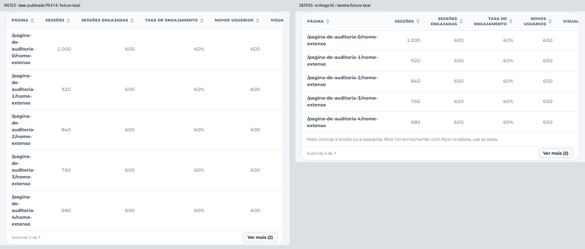
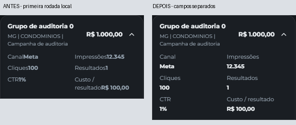

# Entrega 05 · Tabelas legíveis e rolagem acessível

Estado: **publicado; validação local e leitura pública confirmadas; homologação autenticada pendente**. Base publicada: `5970651b08756d49608af19e3bb5f7644c1431f0`, após o PR #14.

## F07/P2

As tabelas de campanhas, detalhamento e as três tabelas GA4 usam uma região compartilhada. Nomes têm largura mínima de 14 rem e números de 6,5 rem; cabeçalhos podem quebrar em linhas. URLs extensas quebram dentro da célula. O custo é rolagem horizontal **interna e intencional** quando as colunas não cabem, preservando a largura da página.

Somente quando há continuação, a região recebe nome acessível, foco por Tab e uma indicação textual. As setas usam o comportamento nativo do navegador; nenhum atalho global é capturado. O estado acompanha a largura da tabela, o contêiner e as fontes. No celular continuam os cartões existentes, com proteção para URLs sem espaços. A impressão desativa as larguras mínimas e a indicação de rolagem para conservar a composição impressa.

A inspeção dos cartões móveis revelou rótulos colados aos valores nos campos expandidos. O valor passa para sua própria linha dentro do mesmo campo, com verificação geométrica de separação. A impressão também recebe menos espaço interno nas células: a primeira checagem encontrou uma tabela 28 px mais larga que a página, sem necessidade de reduzir a fonte ou retirar colunas.

Não mudam ordenação, Top 5/expansão, valores, colunas, filtros, consulta das fontes nem previews. `DataTable.tsx` troca apenas o contêiner externo da tabela; renderização/zoom de mídias não são alterados. As extensões da fixture de entidades e URLs pertencem somente ao transporte sintético de testes.

## Verificações

- **66/66 testes relevantes**: tabelas GA4, ordenação/expansão sobre o conjunto completo, detalhamento e thumbnails assinadas/lightbox.
- Typecheck/build aprovados.
- **5/5 cenários críticos**: cinco composições de tabelas em 768/360 px, URL longa no celular, redimensionamento sem aviso antigo e estados vazio/erro parcial.
- **21/21 cenários finais de tabelas** aprovados: seis resoluções, dois temas, nomes/URLs longos, teclado, última coluna, ordenação, expansão, cartões móveis, vazio/erro parcial, redimensionamento e largura de impressão.
- **6/6 cenários de navegação** aprovados na rodada ampla: diálogos/teclado em quatro tamanhos, períodos, apresentação, tema compartilhado, filtros, Top 3/9 e lightbox. Resultados consolidados de rodadas separadas.
- Primeira matriz: 26/27; a falha de largura de impressão foi corrigida. Na primeira revisão dos recortes, 19/21 passaram; as duas falhas eram de posicionamento da captura durante a rolagem. A versão final estabiliza a rolagem antes de capturar e não altera o CSS de produto para isso. Todos os registros foram preservados.
- **37 PNGs finais inspecionados** por composição, com abertura nativa de tablet/celular e dos comparativos. As três tabelas impressas preservam suas colunas na largura de 794 px. Isso não certifica a paginação de todos os tamanhos de papel nem o término das animações de gráficos na captura de impressão.

Reprodução: build com a URL/chave sintéticas da [entrega 02](../02/README.md), seguido de `npx playwright test --config playwright.uiux-tables.config.ts --grep 'tables|long URLs|dialog keyboard|front filters|shared mobile'`. Saídas integrais em `artifacts/uiux-05/`. Nenhuma sincronização ou gravação real.

## Evidências e compatibilidade

O primeiro par usa a base publicada do PR #14. O par móvel compara a primeira rodada local desta entrega com o ajuste dos campos. Os PNGs integrais e os estados de rolagem ficam organizados por caso/resolução em `artifacts/uiux-05/`; as imagens selecionadas são recortes reais, sem reconstrução de texto. [Resultados](validation-summary.json) · [Impressão](print-794-light.png) · [Detalhamento móvel claro](after-detail-360-light.png).

Nas capturas, a rolagem suave da página é desativada apenas pelo teste, e a navegação por setas é aguardada até estabilizar. Isso evita que o cabeçalho fixo contamine um recorte de tabela fora da primeira dobra. O aplicativo conserva seu comportamento; foco e setas continuam exercitados no navegador.

`DataTable.tsx` só ganha o import e a região externa; o código de preview/zoom permanece idêntico. Reconciliar esse contêiner com eventuais alterações futuras do PR #10, preservando sua lógica. Arquivos de produto: `src/components/ui/table-viewport.tsx`, `src/components/AnalyticsTables.tsx`, `src/components/CampaignTable.tsx`, `src/components/DataTable.tsx` e `src/styles.css`.

Homologação autenticada de produção permanece pendente sem sessão autorizada.

## Publicação concluída em 29/10/2026

- [PR #15](https://github.com/jonathanmainel/maria-gasolina-dashboard/pull/15), correção `ed8d819e09d39cc05e097e18bb5ff57dc3c95974`, merge `465ff9b850913ec8e865b5d6b6fdcbd3e08ca1e8`.
- [Actions/Pages](https://github.com/jonathanmainel/maria-gasolina-dashboard/actions/runs/40875280376): **55 arquivos / 624 testes aprovados**, typecheck, build e deploy concluídos.
- [Pages](https://jonathanmainel.github.io/maria-gasolina-dashboard/): HTTP 200, CSS das tabelas confirmado. Login real em 1440×900 e 390×844 nos dois temas sem erros, overflow ou gravações; capturas idênticas às da entrega anterior. [Registro](production-verification.json) · [Comparação de imagens](production-login-comparison.json).
- A leitura autenticada das tabelas em produção permanece **pendente**, por ausência de sessão autorizada. Nenhuma fixture foi usada na leitura pública.
- Restam cinco achados: F08/F13 (P2) e F10/F11/F14 (P3). Próxima entrega: origem do Orgânico e marca no login, após atualizar a base da main.
