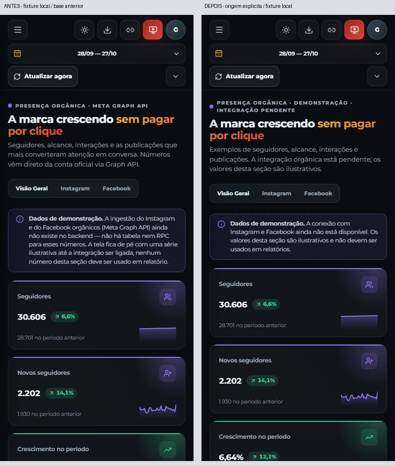
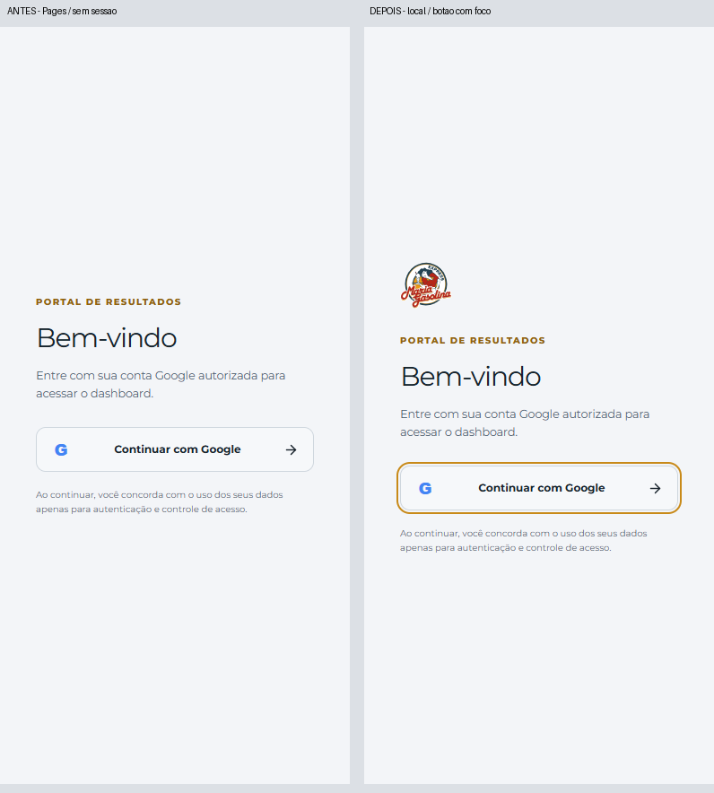

# Entrega 06 · Origem do Orgânico e marca no login

Estado: **corrigido e validado localmente; publicação pendente**. Base publicada: `465ff9b850913ec8e865b5d6b6fdcbd3e08ca1e8`, após o PR #15.

## F08/P2 · Origem explícita desde a primeira leitura

O cabeçalho e o aviso do Orgânico acompanham o metadado de origem. Apenas `supabase` é identificado como conectado; demonstração ou origem não confirmada recebem o aviso ilustrativo. Os números, filtros e geradores existentes permanecem iguais. O texto deixa de prometer conta oficial/Graph API e explica a indisponibilidade sem termos de implementação. O rodapé global também deixa de afirmar sincronização diária de todas as fontes.

A API atual **continua retornando demonstração**. A ramificação conectada foi testada somente no componente com estado controlado; não existe evidência de uma nova integração. Executiva e apresentação continuam protegendo as visualizações operacionais contra números orgânicos ilustrativos, como antes.

## F13/P2 · Marca no login móvel

O logo oficial já presente no card aparece quando o painel lateral é ocultado, até 900 px. Há uma única marca visível em cada composição, imagem proporcional e texto alternativo. Em 901 px e acima permanece o painel lateral. A revisão preserva também o tamanho circular do marcador de títulos quando o novo aviso orgânico quebra de linha.

`Login.tsx` altera **somente o texto alternativo da imagem**. Não mudam botão, função de login, callback, OAuth, credenciais, sessão, permissões ou backend. O teste de erro usa apenas um código inválido sintético no servidor local; não inicia login real.

## Verificações

- **32/32 testes relevantes**, incluindo origem de demonstração/conectada/não confirmada, preservação dos valores e navegação global.
- Typecheck/build aprovados.
- **30/30 cenários Playwright**: seis resoluções e dois temas, áreas equivalentes a zoom 125/150%, limites 900/901 px, filtros orgânicos, foco do botão, callback inválido/retorno e regressão de diálogos/período/apresentação/Top 3/9/lightbox.
- A primeira sondagem teve uma espera incorreta pelo nome do botão: seu nome acessível existente inclui o “G”. O seletor do teste foi corrigido; o botão não foi modificado. Registros preservados.
- **20/20 composições rechecadas** após fixar o tamanho do marcador circular; sem mudança de dados ou autenticação. Os quatro callbacks e seis cenários de navegação são da matriz de 30 cenários anterior, não de uma única rodada final de 30.

Reprodução: build com a URL/chave sintéticas da [entrega 02](../02/README.md), seguido de `npx playwright test --config playwright.uiux-branding.config.ts --grep 'origin and login|callback error|dialog keyboard|front filters|shared mobile'`. Saídas em `artifacts/uiux-06/`. As áreas equivalentes a zoom não são zoom nativo do navegador.

## Evidências e limites

**56 composições inspecionadas**, incluindo as quarenta imagens recapturadas das vinte composições finais. [Resultados](validation-summary.json).

O par orgânico usa a mesma demonstração preexistente e período controlado. No par de login, o “antes” é a leitura pública da entrega 05, sem sessão; o “depois” é local com o botão focado. A borda de foco já existia e não é uma alteração da marca. A comparação pública após o deploy será registrada separadamente. [Login tablet](login-768-dark.png) · [Limite de 901 px](login-901-light.png).

Homologação autenticada do Orgânico e login real via OAuth permanecem fora da evidência disponível, sem sessão/credenciais autorizadas. A leitura pública do login poderá confirmar a marca após a publicação.
