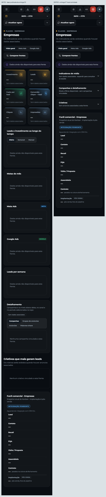
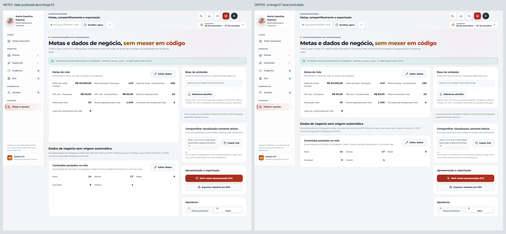

# Entrega 07 — Composição dos painéis e contratos de layout

Escopo aprovado: **F10, F11 e F14 (P3)**, sobre a main `91105a3e6d9ad71cad6b633187e58a11473d62f8`, após a publicação e leitura pública da entrega 06.

## Correções

Nas frentes Empresas, Academias e Hospitais, mídia indisponível fica em três seções recolhíveis: indicadores, campanhas/detalhamento e criativos. O aviso principal e o funil comercial continuam expostos. Expandir usa `details`/`summary` nativos, inclusive Enter e Espaço; filtros e ausência de valores são preservados. Não há métricas fictícias.

Painéis empilhados usam a altura do conteúdo. A Executiva solicita explicitamente o preenchimento de altura que já fazia parte de sua composição. Settings e CRM não esticam os cards para ocupar a altura da coluna vizinha. O editor permanece no próprio painel; não foi transformado em modal.

As declarações móveis repetidas do herói foram consolidadas mantendo o resultado efetivo anterior. O [contrato de composição](../../UI_CONTRACTS.md) registra responsabilidades, limites de adaptação e prevenção de regressões. Não houve reescrita de CSS, nova biblioteca ou remoção de componentes legados sem prova de consumidores.

Arquivos de produto: `src/styles.css`, `src/views/FrontView.tsx`, `src/views/Executive.tsx`; `Settings.tsx` e `Crm.tsx` atualizam somente comentários. A implementação de `CreativeCard`, seleção/ranking, previews, dados, cálculos, permissões, persistência, sincronização e backend não foram alterados. A estrutura em `FrontView` restringe-se à função das frentes indisponíveis.

## Verificação e evidências

- **48/48 testes unitários relevantes em cinco arquivos**, em duas execuções (35 + 13): frentes indisponíveis, CRM, Executiva, origem e permissões de Settings.
- Typecheck e build aprovados; permanece o aviso preexistente de chunks grandes.
- **27/27 cenários Playwright em uma execução**, sem falhas ou reexecuções automáticas. Mais **2/2 cenários desktop/móvel** após a compilação final, que inclui o contorno de foco com o token de texto contrastante.
- **165 composições de painéis inspecionadas em 21 pranchas**, com recortes em escala de leitura e dois pares antes/depois. A rechecagem final acrescenta vinte imagens. Os doze PNGs de diálogos pertencem à regressão de teclado e não entram nessa contagem de painéis.
- Nenhuma gravação, sincronização ou origem externa permitida pelo transporte local. [Resultado consolidado](validation-summary.json) · [Hashes](images-manifest.json).

Antes/depois usa transporte local controlado, período fixo e ausência de associação de mídia. Os arquivos de origem dos pares anteriores foram capturados sobre a entrega 03 e utilizados na entrega 04; as entregas 04–06 não mudaram o empilhamento nem as seções indisponíveis. O cabeçalho/rodapé e ajustes já publicados podem diferir nos pares; não são efeitos atribuídos a esta entrega.

[Seções expandidas em 360 px](expanded-company-360-dark.png) · [Editor em 360 px](editor-settings-360-light.png) · [CRM em 768 px](crm-768-light.png) · [Executiva em 1024 px](executive-1024-dark.png) · [Herói móvel preenchido localmente](hero-mobile-dark.png).

Os testes estão em `e2e/uiux-panels.spec.ts`, executados com `playwright.uiux-panels.config.ts`. Incluem seis resoluções/dois temas, áreas equivalentes a zoom 125/150%, três perfis, leitura vazia/preenchida, edição/cancelamento sem gravação, abertura/fechamento por teclado, comparação e preservação dos filtros. A regressão de navegação cobre também períodos, fontes, apresentação, Top 3/9 e lightbox. As áreas equivalentes não representam zoom nativo do navegador.

As capturas completas e os relatórios brutos permanecem em `artifacts/uiux-07/`; as evidências selecionadas e hashes ficam neste diretório. A primeira execução parcial foi interrompida ao identificar capturas com rolagem residual. O roteiro final volta ao topo e espera a estabilização dos gráficos. Não foi uma correção da aplicação.

Homologação autenticada de produção permanece pendente, sem sessão autorizada. Dados, imagens e sessões sintéticos são evidência local, nunca evidência de produção.

## Publicação concluída em 29/10/2026

- [PR #17](https://github.com/jonathanmainel/maria-gasolina-dashboard/pull/17), correção `e8b5aa519a0feb4a12c6815fb28d2d24e107bc0c`, merge `33c7e11627bfa8bcb73b388bc3902dd88f089dca`.
- [Actions/Pages](https://github.com/jonathanmainel/maria-gasolina-dashboard/actions/runs/40887762415): **55 arquivos / 627 testes aprovados**, typecheck, build e deploy concluídos com sucesso.
- [Aplicação real](https://jonathanmainel.github.io/maria-gasolina-dashboard/): HTTP 200; CSS e código publicados contêm as novas seções e regras de composição. Login inspecionado em 1440×900 e 390×844 nos dois temas, sem erros de execução/configuração, overflow ou requisições de gravação. [Registro](production-verification.json) · [Login real](production-login-390-light.png).
- As quatro imagens públicas são idênticas byte a byte às da entrega 06, confirmando a preservação do login. [Comparação](production-comparison.json).
- O primeiro verificador esperava a escrita longa de `flex`. A leitura dos arquivos confirmou que a compilação produz os equivalentes `flex:none` e `flex:auto`; o verificador local foi corrigido para reconhecer essas formas. Nenhuma alteração da aplicação foi necessária após o merge.
- F10/F11/F14 publicados e validados localmente; leitura autenticada de produção **pendente**. As páginas internas não foram verificadas com uma sessão real, nem substituídas por mocks em produção.
- **Não restam correções de implementação entre os 14 achados aprovados.** [Balanço das sete entregas](../CONCLUSAO.md). O catálogo e o diagnóstico preservam a pendência de homologação autenticada.
