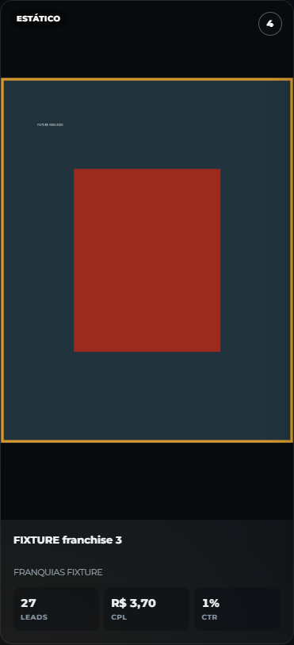
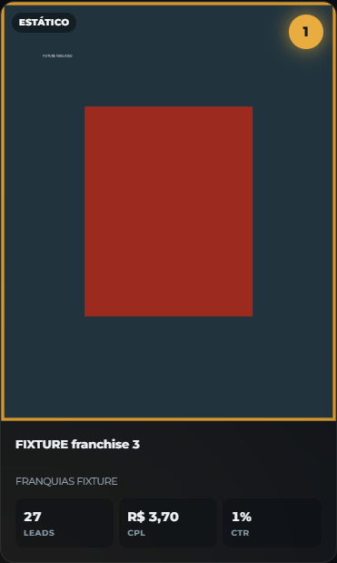
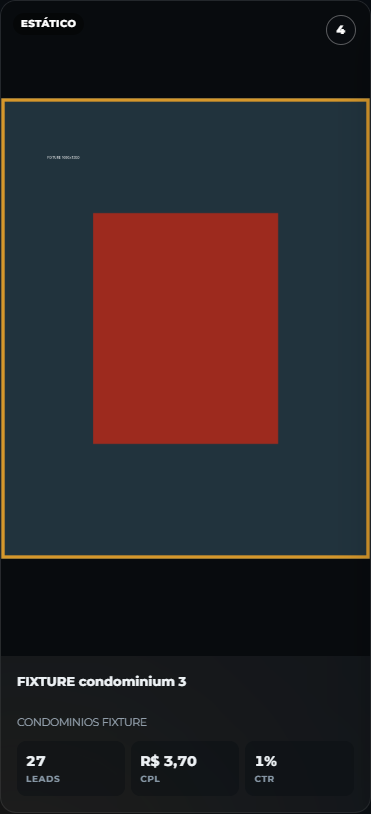
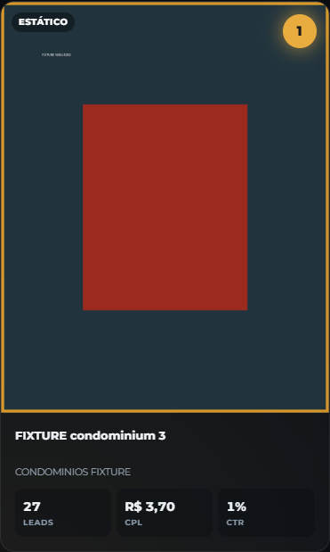
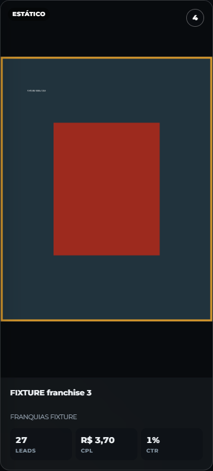
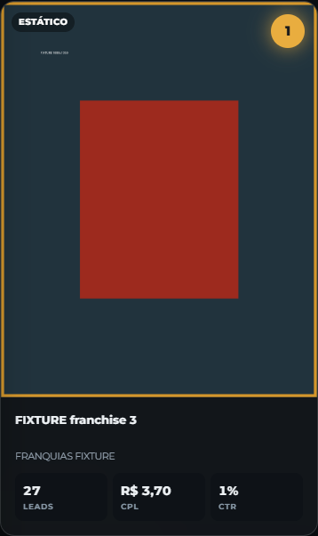
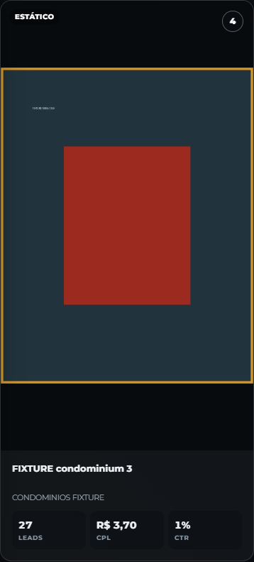
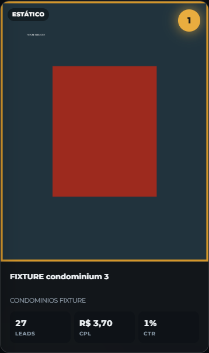

# Criativos por tipo — revisão de 30/10/2026

Branch: `codex/creative-rankings-by-type`, criada a partir de `baae2747195ffd33bdb65a56ca42e801fa455a9c` (`main`, merge do PR #10).

## Resultado

Uma única seção usa o `Segmented` existente com **Vídeos** e **Estáticos**. Frente → Meta Ads → representação → leads decrescentes → ID como desempate → Top 3/9. O tipo é filtrado antes de qualquer limite. Cada ranking começa em 1; alternar categoria reinicia a expansão. A seção é remontada pela chave frente/período, impedindo reutilização do estado anterior. A categoria inicial prioriza vídeos e, na ausência deles, estáticos. Categorias vazias continuam selecionáveis, com mensagem própria.

Vídeos conservam 9:16, `contain`, qualidade, renovação de URL e modal. Estáticos têm área uniforme 4:5 e fundo neutro do tema; imagens quadradas, verticais e horizontais permanecem inteiras. O tamanho nativo limita a ampliação dos estáticos, incluindo arquivos pequenos. A apresentação tem páginas separadas por tipo, até nove de cada, com numeração e categoria preservadas no redimensionamento. Seu enquadramento 4:5 se adapta ao espaço disponível, assim como o enquadramento 9:16 existente.

## Classificação e desempenho

- `creative_type=video` continua sendo vídeo mesmo quando o arquivo de preview é JPEG.
- A representação explícita `preview_media_type` determina os dinâmicos e os carrosséis. A indicação de vídeo já persistida em `object_type`/`video_id` também é aproveitada; não há consulta à Meta para descobrir formato.
- Sem representação comprovada, preserva-se o formato já disponível como fallback. Um dinâmico sem evidência de imagem não recebe artificialmente `preview_media_type=image`.
- A leitura autenticada dos metadados existentes acontece em lotes de até 100 anúncios do período. A seleção dos URLs ocorre depois dessa leitura, dentro da mesma operação, sem uma segunda consulta dos mesmos metadados.
- No máximo nove vídeos e nove estáticos de cada frente recebem assinatura: até 36 URLs para Franquias + Condomínios. O cache por usuário/cliente, TTL, bucket privado e renovação permanecem. Alternar categoria não assina ou baixa novamente os previews já carregados; apenas as imagens efetivamente exibidas são solicitadas pelo navegador.
- Ausência de imagem ou falha de assinatura mantém o anúncio e suas métricas.

## Evidências visuais

**Aplicação real executada localmente com Auth, REST, Storage e imagens sintéticos**, sem chamadas a integrações reais. Os nomes `FIXTURE` identificam o conjunto controlado. Os mesmos dados e imagens foram usados com o código da `main` e da branch. Os recortes de seção ocultam somente a barra fixa externa durante a captura para ela não cobrir a seção; os testes de layout usam a interface normal. Não há arquivos de mídia do cliente, credenciais ou URLs reais assinados nestas evidências.

### A mesma imagem estática antes/depois

O arquivo 1080×1350 era colocado em área 9:16 por ser vertical. Agora a área 4:5 acompanha esse formato, reduzindo espaço vazio; a mudança de posição de 4 para 1 corresponde ao ranking independente.

| Frente / tela | Antes (`main`) | Depois |
| --- | --- | --- |
| Franquias · desktop |  |  |
| Condomínios · desktop |  |  |
| Franquias · mobile |  |  |
| Condomínios · mobile |  |  |

Na comparação medida, o card estático passou de **814 para 619 px** no desktop (largura 371 px) e de **791 para 603 px** no mobile (largura 358 px), cerca de 24% menos altura. O arquivo, seu conteúdo integral e a largura foram mantidos.

### Seção completa

| Frente / viewport | Vídeos | Estáticos |
| --- | --- | --- |
| Franquias · 1440×1000 | [Captura](images/franchise-1440-videos.png) | [Captura](images/franchise-1440-statics.png) |
| Condomínios · 1440×1000 | [Captura](images/condominium-1440-videos.png) | [Captura](images/condominium-1440-statics.png) |
| Franquias · 390×844 | [Captura](images/franchise-390-videos.png) | [Captura](images/franchise-390-statics.png) |
| Condomínios · 390×844 | [Captura](images/condominium-390-videos.png) | [Captura](images/condominium-390-statics.png) |

### Apresentação 3840×2160

| Frente | Vídeos | Estáticos |
| --- | --- | --- |
| Franquias | [4K](images/franchise-creatives-video-0-4k.png) | [4K](images/franchise-creatives-static-0-4k.png) |
| Condomínios | [4K](images/condominium-creatives-video-0-4k.png) | [4K](images/condominium-creatives-static-0-4k.png) |

## Validação

| Verificação | Resultado |
| --- | --- |
| Vitest: 56 arquivos do frontend | **645 testes aprovados** |
| Playwright: categorias, ranking, frente/período, fullscreen e apresentação | **8 cenários aprovados** |
| Playwright: regressão existente de previews, renovação e modal | **6 cenários aprovados** |
| Comparativo com código da main | **4 cenários aprovados** |
| Recaptura final desktop/mobile | **4 cenários aprovados** |
| TypeScript `tsc --noEmit` | Aprovado |
| Build Vite + preparação do pacote | Aprovado |
| `tests/sites-worker.test.mjs` | **4 testes aprovados** |
| Diff/escopo e links das 20 imagens | Aprovados |

Após timeouts locais na tentativa concorrente, a rodada final foi concluída sequencialmente. O Vitest usou dois workers e timeout de 15 segundos por teste nessa rodada, excluindo `artifacts/**` e `.npm-cache/**` para não executar cópias locais de código/dependências. Nenhum teste da aplicação foi removido. O build conserva o aviso de chunks grandes, também observado no baseline.

Cobertura: dinâmicos de vídeo/imagem, carrossel, vídeo com thumbnail de imagem, empate por ID, nove de cada categoria fora do Top 9 geral, lote de 205 metadados, ausência de autenticação, ausência de anúncios/preview, preservação de indicadores, Top 3/9 e reset, navegação de frente/período, cache/assinatura limitada, modal integral e paginação em desktop/mobile/4K.

## Preservação do PR #10 e limites

O diff não altera `supabase/`, Storage, integração, protocolo operacional de recuperação, `ImageLightbox`, classificação comercial nem fórmulas de métricas. Os quatro arquivos publicados, seus objetos anteriores e suas referências persistidas não receberam gravação alguma nesta entrega. Os testes cobrem arquivos 720×1280 e 1080×1920, URL vencida, cache, falha de assinatura, indisponibilidade e modal.

Isso comprova a regressão local do frontend; não representa uma publicação ou uma nova homologação dos quatro arquivos na aplicação de produção com este código. Nenhum merge, deploy de frontend/Edge Function ou migration foi executado. O PR aguarda revisão.

## Arquivos de implementação

- `src/views/FrontView.tsx`: seção, seletor, estado e apresentação dos cards.
- `src/lib/creatives.ts`: classificação compartilhada, ranking e seleção por tipo.
- `src/lib/api.ts`: classificação antes de selecionar URLs.
- `src/lib/creative-previews.ts`: leitura de metadados e seleção limitada para assinatura, mantendo autenticação/cache.
- `src/views/Presentation.tsx`, `src/lib/presentation-layout.ts`, `src/presentation.css`: páginas por tipo e enquadramento responsivo.
- `src/styles.css`: área 4:5, fundo neutro e cabeçalho responsivo.

Testes: `src/views/CreativeSection.test.tsx`, `src/lib/creatives.test.ts`, `src/lib/creative-previews.test.ts`, `src/lib/presentation-layout.test.ts`, `tests/creative-categories.spec.ts`, `tests/meta-preview-quality.spec.ts` e ajuste de ID esperado em `e2e/uiux-legibility.spec.ts`. Suporte: `playwright.creative-categories.config.ts`, `tests/serve-creative-categories-test.mjs`, `tests/fixtures/meta-preview-app.ts`, `tests/fixtures/meta-previews/generate.py` e `square.png`. Este relatório e suas imagens completam a entrega.

## Reprodução

- Tipos: `npm run typecheck`.
- Testes unitários: os 56 arquivos `src/**/*.test.ts(x)`; excluir `artifacts/**` e `.npm-cache/**` caso haja snapshots/copias locais de dependências.
- Categorias, navegação e apresentação: `node node_modules/@playwright/test/cli.js test --config playwright.creative-categories.config.ts`.
- Regressão de previews: `node node_modules/@playwright/test/cli.js test --config playwright.meta-previews.config.ts`.
- Comparação anterior: arquivar o commit base em `artifacts/creative-categories/baseline-source` e executar a configuração de categorias com `CREATIVE_BASELINE_ROOT` apontando para esse diretório e `--grep categorias`.
- Build: `npm run build`; embalagem: `npm run test:sites`.
